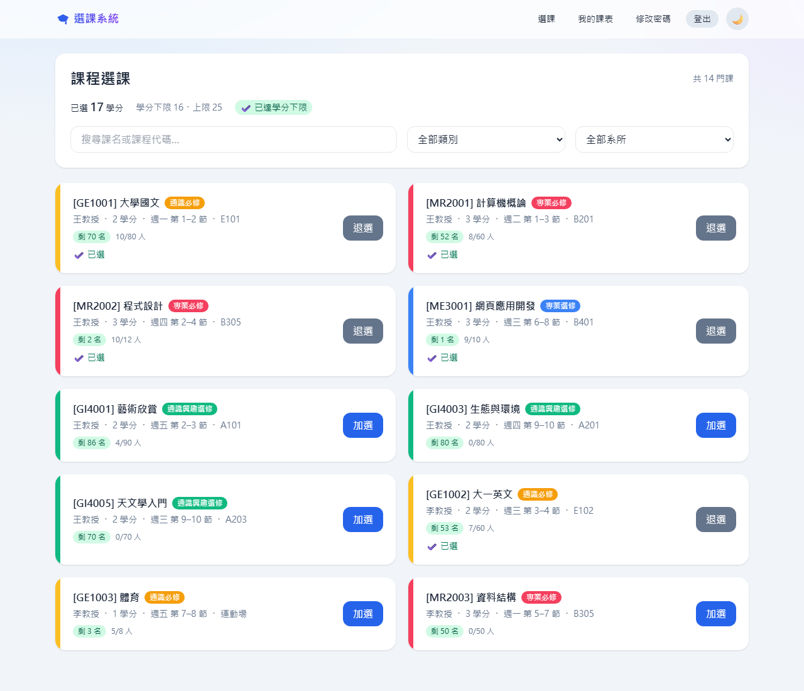
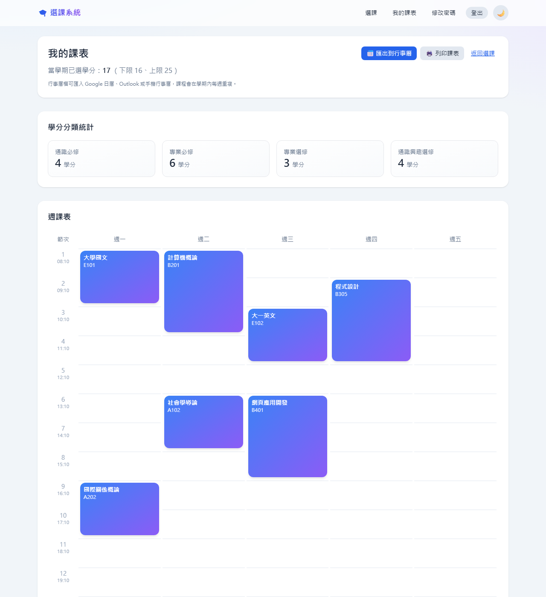
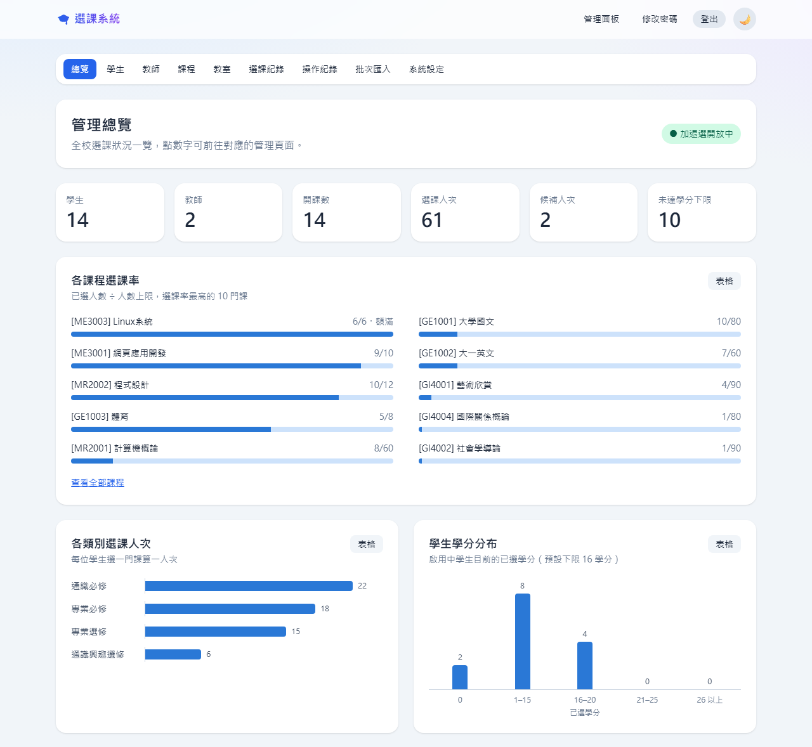

# 大專院校課表與選課維護系統

一套線上選課與課表管理系統：

- **學生**：線上選課、查看課表。
- **教師**：管理自己開的課程與修課名單。
- **教務處**：統一管理學生、教師、課程、教室與加退選期間。

**線上展示：** https://course-system-681r.onrender.com/



## 目錄

- [線上展示](#線上展示)
- [功能](#功能)
- [選課規則](#選課規則)
- [在自己的電腦上執行](#在自己的電腦上執行)
- [部署到 Render](#部署到-render)
- [批次匯入資料](#批次匯入資料)
- [專案結構](#專案結構)
- [開發與測試](#開發與測試)
- [已知限制與未來規劃](#已知限制與未來規劃)

## 線上展示

網址：https://course-system-681r.onrender.com/

登入頁下方有「展示用快速填入」按鈕，點一下就會帶入對應身分的帳號密碼。

| 身分 | 帳號 | 密碼 | 說明 |
|---|---|---|---|
| 學生 | `student1` | `student123` | 二年級，資訊管理系 |
| 學生 | `student2` | `student123` | 三年級，可以選限三、四年級修習的課 |
| 教師 | `teacher1` | `teacher123` | 王教授 |
| 教師 | `teacher2` | `teacher123` | 李教授 |
| 教務處 | `admin` | `admin123` | 管理員，可以使用管理面板 |

> [!NOTE]
> - 展示網站使用 Render 免費方案，閒置一段時間會休眠，第一次開啟可能要等約 1 分鐘。
> - 展示網站的資料在重新部署、重新啟動或休眠喚醒後，都會回到初始的示範資料，請不要存放重要資料。

## 功能

### 學生

- **選課**：用關鍵字、類別或系所找課。每門課都會顯示剩餘名額、是否衝堂、是否符合修課資格。加選和退選不用重新整理頁面。
- **候補**：額滿的課可以登記候補。有名額空出時，系統會依順位自動加選。
- **我的課表**：包含週課表（附每節上課時間）與四類學分統計。學分未達下限時會提醒。
- **匯出課表**：可以下載行事曆檔，匯入 Google 日曆、Outlook 或手機行事曆；也可以直接列印。
- **修改密碼**。



### 教師

- 開設、編輯、刪除自己的課程。可以設定教室、人數上限、修課資格（限定系所或年級）與課程大綱。
- 查看選課名單與候補名單，並下載成 Excel 可以開啟的 CSV 檔。

### 教務處（管理員）

- **總覽**：學生人數、選課人次、各課程選課率、學生學分分布等統計圖表。每張圖都可以切換成表格閱讀。
- **學生與教師**：新增、編輯、停用帳號，替忘記密碼的人重設密碼；可以個別調整每位學生的學分上下限，也可以篩選出還沒達到學分下限的學生。
- **課程與教室**：可以替任何教師開課，並管理教室與容納人數。
- **選課紀錄**：查詢所有選課紀錄，必要時可以強制退選。
- **操作紀錄**：登入、選課、修改資料等操作都會留下紀錄，可以依人員、動作或日期查詢。
- **批次匯入**：用 Excel 一次匯入學生、教師或課程。
- **系統設定**：設定加退選開放期間與學期起訖日。

所有清單都可以搜尋，資料多時會自動分頁。



## 選課規則

學生加選、登記候補，以及教師或管理員修改課程時，系統都會自動檢查以下規則：

| 規則 | 說明 |
|---|---|
| 衝堂 | 同一個時段只能選一門課。 |
| 人數上限 | 額滿後不能加選，但可以登記候補。 |
| 學分上下限 | 每學期預設 16–25 學分，管理員可以依學生個別調整。加選後超過上限的課不能選。未達下限時只會提醒，不會擋下任何操作。 |
| 退選 | 已經達到學分下限的學生，退選後不能低於下限。想換課請先加選新課，再退選舊課。 |
| 修課資格 | 課程可以限定系所或年級，不符合的學生不能選。 |
| 加退選期間 | 管理員可以設定開放時間，期間外學生只能瀏覽課程。 |
| 候補遞補 | 有人退選、管理員強制退選或課程調高人數上限時，依登記順序自動遞補。遞補時一樣檢查衝堂、學分與資格，不符合的人保留順位，先遞補下一位。 |
| 排課 | 同一位教師、同一間教室在同一個時段都只能排一門課。課程人數上限不能超過教室的容納人數。 |
| 課程異動 | 已經有學生選的課，修改後不能讓這些學生衝堂、超過學分上限或失去修課資格。人數上限也不能低於目前的選課人數。 |

## 在自己的電腦上執行

需要先安裝 [Python](https://www.python.org/downloads/) 3.10 以上的版本（開發時使用 3.13）。在 Windows 安裝時，請勾選「Add Python to PATH」。

### Windows：一鍵啟動

1. 下載或 clone 這個專案。
2. 雙擊專案資料夾裡的 `start.bat`。

第一次執行時，它會自動建立虛擬環境、安裝套件、建立資料庫並放入示範資料，完成後會自動開啟 http://127.0.0.1:8000/ 。

之後每次執行，只會補上缺少的示範資料，不會覆蓋你修改過的課程；但示範帳號的密碼會重設回預設值。

### 手動執行（Windows、macOS、Linux）

```bash
python -m venv venv

# 啟用虛擬環境
venv\Scripts\activate          # Windows
source venv/bin/activate       # macOS / Linux

pip install -r requirements.txt
python manage.py migrate       # 建立資料庫
python manage.py seed_data     # 放入示範資料（可省略）
python manage.py runserver     # 啟動後打開 http://127.0.0.1:8000/
```

macOS 與 Linux 的指令可能是 `python3` 而不是 `python`。

### 建立自己的管理員帳號

```bash
python manage.py createsuperuser
```

用這個指令建立的帳號會自動成為教務處管理員。管理員也能進入網址 `/admin/`，這是 Django 內建的資料庫後台，可以直接檢視與修改資料。

## 部署到 Render

1. 在 [Render](https://render.com/) 建立一個 **Web Service**，並連結這個 GitHub 專案。
2. 填入以下設定：

   | 項目 | 值 |
   |---|---|
   | Runtime | Python 3 |
   | Build Command | `bash build.sh` |
   | Start Command | `gunicorn course_system.wsgi:application` |

3. 在 **Environment** 新增環境變數：

   | 名稱 | 說明 |
   |---|---|
   | `DJANGO_SECRET_KEY` | **必填**。一串夠長的隨機字串，可以按 Render 的「Generate」產生。沒有設定的話，部署會失敗。 |

不用自己設定 `RENDER` 和 `RENDER_EXTERNAL_HOSTNAME`，Render 會自動提供。系統會用它們關閉除錯模式，並設定網域與 HTTPS。

每次部署時，`build.sh` 會依序執行：
1. 安裝套件。
2. 整理靜態檔案。
3. 更新資料庫結構。
4. 放入示範資料。

Render 預設會在每次 push 到 `main` 分支時自動重新部署。

### 正式上線前

這個專案目前的設定以展示為主。如果要正式給師生使用，建議先完成以下三件事：

- **改用會長期保存的資料庫**，例如 PostgreSQL。Render 的檔案系統在重新部署或重新啟動後會清空，SQLite 的資料會跟著消失。
- **移除公開的示範帳號**：刪掉登入頁的「展示用快速填入」按鈕（`courses/templates/courses/login.html`），並拿掉 `build.sh` 中的 `python manage.py seed_data`。
- **建立正式的管理員帳號**：用 `createsuperuser` 建立，並設定強密碼。

## 批次匯入資料

到「管理面板」→「批次匯入」：

1. 下載範例檔（學生、教師、課程各一份）。
2. 用 Excel 填寫後另存成 CSV 檔（UTF-8 或 Big5 都可以）。
3. 上傳檔案。

系統會逐列檢查，**全部正確才會寫入**。只要有任何一列有錯，就不會寫入任何資料，並列出是第幾列、哪個欄位有問題。

- 建議的匯入順序：**教師 → 學生 → 課程**。課程會用到教師帳號和教室，教室請先在「教室」頁面建立。
- 學生和教師一次最多匯入 100 筆，課程最多 300 筆。
- 如果所有人使用相同的初始密碼，匯入速度最快。

## 專案結構

```text
course_system/
├── course_system/              Django 專案設定
│   ├── settings.py             資料庫、安全性與靜態檔設定
│   └── urls.py                 登入、登出、修改密碼與 /admin/ 的網址
├── courses/                    選課系統主程式
│   ├── models.py               資料表：使用者、學生、教師、教室、課程、選課、候補、操作紀錄、系統設定
│   ├── services.py             選課規則：衝堂、學分、修課資格、候補遞補
│   ├── views.py                學生與教師的頁面
│   ├── admin_views.py          教務處管理面板
│   ├── forms.py                表單與輸入檢查
│   ├── imports.py              CSV 批次匯入
│   ├── exports.py              名單 CSV 與課表行事曆匯出
│   ├── utils.py                身分判斷、操作紀錄、分頁等共用工具
│   ├── tests.py                自動化測試
│   ├── management/commands/
│   │   └── seed_data.py        示範資料
│   ├── migrations/             資料庫結構的變更紀錄
│   └── templates/courses/      網頁樣板（manage/ 是管理面板）
├── docs/images/                README 用的截圖
├── build.sh                    Render 部署腳本
├── start.bat                   Windows 一鍵啟動
├── requirements.txt            Python 套件清單
└── manage.py                   Django 管理指令入口
```

使用的技術：Python、Django 5.2、SQLite、Tailwind CSS、WhiteNoise、Gunicorn。

## 開發與測試

```bash
python manage.py test courses                        # 執行全部自動化測試
python manage.py makemigrations                      # 修改 models.py 之後，產生資料庫變更檔
python manage.py makemigrations --check --dry-run    # 確認沒有漏掉的資料庫變更
```

自動化測試涵蓋選課規則、候補、權限、管理功能、匯入匯出與先前修正過的問題。修改程式後，請先確認測試全部通過再 push。

## 已知限制與未來規劃

**已知限制**

- 資料庫使用 SQLite，適合展示與小規模使用，正式環境建議改用 PostgreSQL。
- 樣式透過 CDN 載入 Tailwind CSS，正式環境建議改成預先編譯好的 CSS 檔。

**未來規劃**

- 學期與歷年修課紀錄
- 成績登錄
- 先修課程檢查
- 一門課有多個上課時段
- Email 通知
